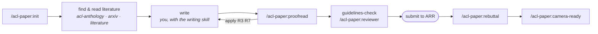
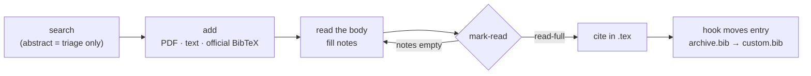

<div align="center">

# 📝 acl-paper-skills

**Claude Code skills that check your ACL paper before reviewers do.**

Proofreading reports · citations verified against full text · ACL Anthology & arXiv literature · automatic bib sync · ARR guideline checks · simulated reviews · rebuttal & camera-ready help

[](https://github.com/NilsHellwig/acl-paper-skills/actions/workflows/test.yml)
[](https://github.com/NilsHellwig/acl-paper-skills/actions/workflows/upstream.yml)
[](CHANGELOG.md)
[](https://docs.claude.com/en/docs/claude-code/plugins)
[](pyproject.toml)
[](LICENSE)

</div>

> [!IMPORTANT]
> **For quality control, not ghostwriting.** These skills are built to check and sharpen a paper *you* wrote: find unsupported claims, verify every citation against the cited paper's body, catch machine-sounding prose and guideline violations. They can draft on request, but every default is reviewer and editor, never author.

---

## ✨ What it does

| | |
|---|---|
| 🔎 **Proofread into a report** | Content, citations, language, AI style, consistency and ACL compliance, each finding with 🔴/🟠/🟢 severity in `report.md`. Apply items one by one when you agree. |
| 📚 **Literature that is actually read** | Search the ACL Anthology and arXiv, store PDF + text, and keep reading notes. A paper counts as citable only after its **body** was read, never on its abstract. |
| 🔗 **Bib that maintains itself** | Cite a key and its official BibTeX entry moves into your `.bib`; remove the last citation and it moves out. BibTeX is never generated by the model. |
| 📋 **Current ARR rules, every time** | CFP, author checklist, Responsible NLP checklist, review form, ACLPUB final-version guide: fetched fresh from GitHub on each run, never stale copies. |
| 🧑‍⚖️ **Review, rebuttal, camera-ready** | A simulated ARR review on the official form, a structured author response from your reviews, and a camera-ready check against the publication guides. |
| ✍️ **No AI tells** | Writing rules distilled from Wikipedia's *Signs of AI writing*, extended with your own style rules in `CLAUDE.md`. |

## 🚀 Quickstart

```text
# 1. In Claude Code, add the marketplace and install the plugin
/plugin marketplace add NilsHellwig/acl-paper-skills
/plugin install acl-paper@acl-paper-skills

# 2. Open your paper folder (official ACL LaTeX template) and set it up
/acl-paper:init

# 3. Get a first report
/acl-paper:proofread
```

`init` asks which Python environment to use (existing venv, conda, a new `uv` env, or a path), checks `pdftotext`, and creates the project files. It installs nothing without asking.

**Requirements:** Claude Code · Python ≥ 3.10 · `pdftotext` (poppler: `brew install poppler` / `apt install poppler-utils`) · a paper based on [acl-org/acl-style-files](https://github.com/acl-org/acl-style-files).

## 🧭 Workflow



## 🧰 Skills

**You call these** (slash commands):

| Command | What it does |
|---|---|
| `/acl-paper:init` | Set up the project: config, literature folder, `report.md`, `CLAUDE.md` with your style rules, Python env, checks. |
| `/acl-paper:proofread [file\|section]` | Full review into `report.md`. `/acl-paper:proofread apply R3 R7` applies items. |
| `/acl-paper:reviewer [persona]` | Simulated ARR review on the current official form → `review.md` + report items. |
| `/acl-paper:rebuttal [limit]` | Triage the reviews in `reviews/`, check each point against the paper, draft `rebuttal.md`. |
| `/acl-paper:camera-ready [venue]` | Check and prepare the final version against ARR, ACL and ACLPUB guides. |
| `/acl-paper:new-source [name]` | Add another literature source (Semantic Scholar, ACM, OpenReview, ...) to this project. |

**Claude reaches these on its own** (and you can call them too):

| Skill | When |
|---|---|
| `writing` | Any time paper prose is written or edited. |
| `literature` | Before judging or citing a paper; when you drop a PDF or paste BibTeX. |
| `acl-anthology` | Searching or fetching ACL Anthology papers. |
| `arxiv` | Searching or fetching arXiv preprints. |
| `guidelines-check` | Checking the paper against current ARR rules (also run by `reviewer`). |

## 📂 What your project looks like

```text
my-paper/
├── acl_latex.tex           # your paper (official ACL template)
├── custom.bib              # holds exactly the cited entries, kept in sync
├── paper.config.json       # env, main file, bib, English variant, sources
├── CLAUDE.md               # purpose, literature rules, YOUR style rules
├── report.md               # findings: 🔴 high · 🟠 medium · 🟢 low
├── reviews/                # (rebuttal) pasted reviews
└── literature/
    ├── pdf/<key>.pdf
    ├── md/<key>.md         # pdftotext -layout
    ├── notes/<key>.md      # what was read, claims with body locations
    ├── index.md            # generated overview
    └── archive.bib         # fetched or formerly cited, not cited now
```

## 🔬 How citations stay honest



- **The body is the evidence.** `mark-read` refuses until the notes say what was read and list claims with their location in the paper. The hook warns about every cited key that is not `read-full`.
- **BibTeX comes from the source.** ACL Anthology entries from the Anthology, arXiv entries from arxiv.org, anything else pasted by you. A cited key without an entry is reported, never invented.
- **One file, always in sync.** After every `.tex` edit the hook moves entries between `custom.bib` and `literature/archive.bib`, offline and in milliseconds.

## 📋 Fresh guidelines, never copies

ARR and ACL rules change every cycle, so this repo stores only **where** they live ([`guideline_sources.json`](scripts/paperkit/data/guideline_sources.json)). Each run of `guidelines-check`, `reviewer`, `rebuttal` and `camera-ready` downloads them from:

- [acl-org/aclrollingreview](https://github.com/acl-org/aclrollingreview): CFP, author checklist, Responsible NLP checklist, author guide, review form, reviewer guidelines
- [acl-org/acl-style-files](https://github.com/acl-org/acl-style-files): formatting guidelines
- [acl-org/ACLPUB](https://github.com/acl-org/ACLPUB): final-version and formatting guides

If a document moved, the skill says so and stops instead of guessing. A weekly CI job checks every URL and opens an issue on drift.

## ⚙️ Configuration

`paper.config.json` (written by `init`, safe to edit):

```json
{
  "python": "/path/to/env/bin/python",
  "main_tex": "acl_latex.tex",
  "bib": "custom.bib",
  "english": "us",
  "key_scheme": "native",
  "sources": {
    "acl-anthology": "builtin",
    "arxiv": "builtin",
    "semantic-scholar": ".claude/skills/semantic-scholar-source/adapter.py"
  },
  "abbreviation_allowlist": ["ACL", "NLP", "GPU", "..."]
}
```

Your own writing rules go in `## Style` of the project's `CLAUDE.md`; they override the plugin's defaults. `init` offers an example profile to start from.

## 🔌 Adding a literature source

`/acl-paper:new-source semantic scholar` researches the API, writes a small adapter (`search`, `fetch_pdf`, `bibtex`) into `.claude/skills/<name>-source/`, tests it end to end, and creates a matching project skill. The core handles everything else: duplicates, files, notes, bib sync. Sources only qualify if they provide an authoritative BibTeX entry.

<details>
<summary><b>❓ FAQ</b></summary>

**Does it work with Overleaf?**
Yes, through Overleaf's Git or GitHub sync: work on a local clone with Claude Code, push back.

**How big is the ACL Anthology download?**
About 300 MB of metadata, cloned once to `~/.cache/acl-paper/anthology` and shared by all projects. Searches then run offline; `paperkit.py anthology-update` refreshes it.

**Will it rewrite my paper?**
Only items you ask it to apply, with minimal edits shown as before → after. `proofread` and `reviewer` write to `report.md` and `review.md` only.

**Can I use it for non-ACL venues?**
The literature, bib and writing parts work for any LaTeX + BibTeX paper. The guideline skills are ARR-specific.

**Where do my reviews and unpublished results go?**
Nowhere beyond your Claude Code session and your project folder. The scripts only contact the ACL Anthology, arXiv and GitHub (for guidelines).

</details>

## 🤝 Contributing

Bug reports, source proposals and guideline drift reports have [issue forms](.github/ISSUE_TEMPLATE). See [CONTRIBUTING.md](CONTRIBUTING.md) for setup, tests and the release process, and [CHANGELOG.md](CHANGELOG.md) for what changed.

## 🙏 Acknowledgments

- Structure inspired by [mattpocock/skills](https://github.com/mattpocock/skills).
- Writing patterns distilled from [Wikipedia: Signs of AI writing](https://en.wikipedia.org/wiki/Wikipedia:Signs_of_AI_writing).
- Built on the [`acl-anthology`](https://github.com/acl-org/acl-anthology) and [`arxiv`](https://github.com/lukasschwab/arxiv.py) Python packages and the ACL Rolling Review documentation.

## 📄 License

[MIT](LICENSE) © Nils Hellwig
